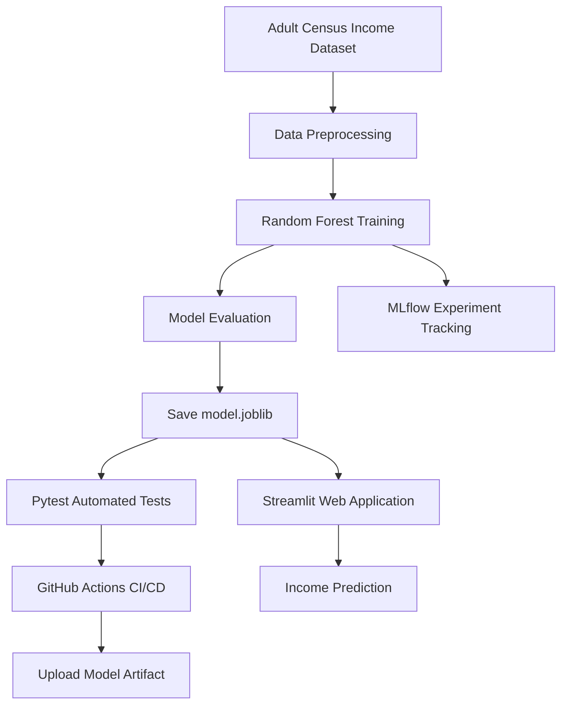

# Adult Census Income Prediction — End-to-End MLOps Project

[](https://github.com/farhheenkhan254-fk/mlops-model-training/actions/workflows/ml-pipeline.yml)

An end-to-end Machine Learning Operations (MLOps) project that predicts whether an individual's annual income is `<=50K` or `>50K` using the Adult Census Income dataset and a Random Forest classifier.

The project demonstrates data processing, model training, evaluation, experiment tracking with MLflow, automated testing with Pytest, continuous integration and continuous delivery (CI/CD) using GitHub Actions, and deployment of an interactive web application using Streamlit.

## Live Application

**Try the deployed application:**
https://mlops-model-training-8jhfnme7x2han4vexr6xff.streamlit.app/

**GitHub Repository:**
https://github.com/farhheenkhan254-fk/mlops-model-training

## Project Overview

This project follows a complete machine learning lifecycle:

1. Load the Adult Census Income dataset.
2. Preprocess the data and prepare features.
3. Train a Random Forest classification model.
4. Evaluate the model using classification metrics.
5. Save the trained model as `model.joblib`.
6. Track experiments and metrics using MLflow.
7. Run automated tests using Pytest.
8. Automate model training and testing with GitHub Actions.
9. Upload the trained model as a GitHub Actions artifact.
10. Deploy an interactive prediction application using Streamlit.

## Architecture and Workflow



## Technology Stack

| Technology       | Purpose                                      |
| ---------------- | -------------------------------------------- |
| Python           | Main programming language                    |
| Pandas           | Data loading and manipulation                |
| NumPy            | Numerical operations                         |
| Scikit-learn     | Preprocessing, model training and evaluation |
| Joblib           | Saving and loading the trained model         |
| MLflow           | Experiment tracking and model logging        |
| Pytest           | Automated testing                            |
| Git and GitHub   | Version control and source code hosting      |
| GitHub Actions   | CI/CD automation                             |
| Streamlit        | Interactive web application                  |
| Jupyter Notebook | Exploratory analysis and experimentation     |

## Project Structure

```text
mlops-model-training/
│
├── .github/
│   └── workflows/
│       └── ml-pipeline.yml
│
├── data/
│   └── adult.csv
│
├── tests/
│   └── test_model.py
│
├── app.py
├── train.py
├── predict.py
├── model.joblib
├── model_training.ipynb
├── classification_report.txt
├── requirements.txt
├── README.md
└── .gitignore
```

Additional files and directories, such as `mlruns/`, `mlflow.db`, and Python cache files, may be generated locally during training and experimentation.

## Step 1: Clone the Repository

Clone the project from GitHub.

```bash
git clone https://github.com/farhheenkhan254-fk/mlops-model-training.git
cd mlops-model-training
```

**Purpose:** Downloads the source code and moves into the project directory.

**Expected result:** The project files are available on your local machine.

## Step 2: Create and Activate a Virtual Environment

On Windows PowerShell:

```powershell
python -m venv .venv
.\.venv\Scripts\Activate.ps1
```

If PowerShell blocks script execution, you can activate the environment in Command Prompt instead:

```cmd
.venv\Scripts\activate.bat
```

**Purpose:** Creates an isolated Python environment for project dependencies.

**Expected result:** The terminal displays `(.venv)` before the current directory.

## Step 3: Install Dependencies

```bash
python -m pip install --upgrade pip
python -m pip install -r requirements.txt
```

**Purpose:** Installs the libraries required for training, testing, experiment tracking and deployment.

**Expected result:** Dependencies install successfully without unresolved package errors.

## Step 4: Train the Machine Learning Model

```bash
python train.py
```

**Purpose:**

* Loads the Adult Census Income dataset.
* Prepares the input features and target variable.
* Trains the Random Forest classifier.
* Evaluates model performance.
* Saves the trained model to `model.joblib`.
* Logs model metrics and artifacts to MLflow.

**Observed training output:**

```text
Dataset shape: (32561, 15)

===== MODEL EVALUATION =====
Accuracy:  0.8506
Precision: 0.8449
Recall:    0.8506
F1 Score:  0.8464

===== CLASSIFICATION REPORT =====
              precision    recall  f1-score   support

       <=50K       0.88      0.92      0.90      4945
        >50K       0.72      0.62      0.67      1568

    accuracy                           0.85      6513

===== CONFUSION MATRIX =====
Class labels: ['<=50K', '>50K']
[[4574  371]
 [ 602  966]]

Model saved: model.joblib
MLflow metrics and model logged successfully.
```

*Note: The saved model path and exact console output depend on the local environment.*

### Model Performance

| Metric    |  Score |
| --------- | -----: |
| Accuracy  | 85.06% |
| Precision | 84.49% |
| Recall    | 85.06% |
| F1 Score  | 84.64% |

The model achieved approximately 85% accuracy on the test dataset. The classification report also shows that detecting the `>50K` income class is more challenging than detecting the `<=50K` class.

## Step 5: Run Automated Tests

```bash
python -m pytest tests/ -v
```

**Purpose:** Verifies that the dataset exists, the trained model has been saved, and the model can make predictions.

**Observed test output:**

```text
collected 3 items

tests/test_model.py::test_dataset_exists PASSED
tests/test_model.py::test_trained_model_exists PASSED
tests/test_model.py::test_model_prediction PASSED

============================== 3 passed ==============================
```

All three tests passed successfully after the dataset and model were generated.

## Step 6: Run Predictions from the Command Line

```bash
python predict.py
```

**Purpose:** Runs the project's prediction script using the saved model.

**Expected result:** The script executes the prediction workflow defined in `predict.py`.

The exact prediction output depends on the input records and the implementation of the prediction script.

## Step 7: View MLflow Experiments

Start the MLflow tracking interface:

```bash
python -m mlflow ui
```

Open the following URL in your browser:

http://127.0.0.1:5000

**What you can inspect:**

* Experiment runs
* Logged model metrics
* Parameters, if logged
* Model artifacts and associated files

Keep the terminal running while using the MLflow UI. Press `Ctrl+C` to stop the local server.

## Step 8: Run the Streamlit Application Locally

```bash
python -m streamlit run app.py
```

**Purpose:** Starts the interactive web application for income prediction.

Streamlit usually opens the local application automatically. If it does not, open:

http://localhost:8501

**Expected result:** The browser displays the application's interface. Enter the supported input features and submit them to obtain a prediction.

The application loads the saved model, so make sure the model file is available at the path expected by `app.py`.

## Step 9: Configure the GitHub Actions CI/CD Pipeline

The workflow file is located at:

```text
.github/workflows/ml-pipeline.yml
```

The pipeline is configured to run on pushes and pull requests targeting the `main` branch.

Its main steps are:

1. Check out the repository.
2. Set up Python 3.12.
3. Install dependencies from `requirements.txt`.
4. Train the model and log MLflow metrics.
5. Execute the automated tests.
6. Upload `model.joblib` as a workflow artifact if the job succeeds.

**Workflow configuration example:**

```yaml
name: MLOps CI Pipeline

on:
  push:
    branches: [main]
  pull_request:
    branches: [main]

jobs:
  train-and-test:
    runs-on: ubuntu-latest

    steps:
      - name: Checkout repository
        uses: actions/checkout@v4

      - name: Setup Python
        uses: actions/setup-python@v5
        with:
          python-version: "3.12"

      - name: Install dependencies
        run: |
          python -m pip install --upgrade pip
          pip install -r requirements.txt

      - name: Train model and log MLflow metrics
        run: python train.py

      - name: Run tests
        run: python -m pytest tests/ -v

      - name: Upload model artifact
        if: success()
        uses: actions/upload-artifact@v4
        with:
          name: trained-model
          path: model.joblib
          if-no-files-found: error
          retention-days: 7
```

### CI/CD Pipeline Result

The GitHub Actions workflow completed successfully.

* Model training completed.
* All 3 automated tests passed.
* The `trained-model` artifact was uploaded successfully.
* The artifact contains the trained `model.joblib` file.

View the workflow runs here:

https://github.com/farhheenkhan254-fk/mlops-model-training/actions

### How to Download the Model Artifact

1. Open the GitHub Actions link above.
2. Select a successful workflow run.
3. Scroll to the **Artifacts** section.
4. Download `trained-model`.
5. Extract the downloaded ZIP file to access `model.joblib`.

The downloaded artifact is a copy of the model generated by that particular CI run. It is separate from the model file in your repository.

## Step 10: Deploy the Application on Streamlit

The application is deployed using Streamlit Community Cloud.

**Live application:**

https://mlops-model-training-8jhfnme7x2han4vexr6xff.streamlit.app/

Deployment configuration:

| Setting    | Value                                     |
| ---------- | ----------------------------------------- |
| Repository | `farhheenkhan254-fk/mlops-model-training` |
| Branch     | `main`                                    |
| Main file  | `app.py`                                  |

The deployed application uses the dependencies specified in `requirements.txt` and the model file available in the repository or at the path configured by the application.

**Important:** GitHub Actions CI/CD and Streamlit application deployment are separate processes. The GitHub Actions workflow trains and tests the model, while Streamlit Community Cloud hosts the web application. The workflow shown above does not automatically deploy a newly trained model to Streamlit.

## Understanding the Prediction Output

The target variable is the annual income category.

| Output class | Meaning                                    |
| ------------ | ------------------------------------------ |
| `<=50K`      | Predicted annual income of $50,000 or less |
| `>50K`       | Predicted annual income above $50,000      |

The prediction is a machine learning estimate based on the supplied input features, not a guarantee of a person's actual income.

## Common Commands Reference

| Command                                     | Purpose                                 |
| ------------------------------------------- | --------------------------------------- |
| `python -m venv .venv`                      | Create a virtual environment            |
| `.\.venv\Scripts\Activate.ps1`              | Activate the environment in PowerShell  |
| `python -m pip install -r requirements.txt` | Install dependencies                    |
| `python train.py`                           | Train and evaluate the model            |
| `python -m pytest tests/ -v`                | Run automated tests                     |
| `python predict.py`                         | Run the command-line prediction script  |
| `python -m mlflow ui`                       | Start the MLflow UI                     |
| `python -m streamlit run app.py`            | Start the Streamlit application locally |

## Key Learning Outcomes

* Building a complete machine learning workflow.
* Training and evaluating a classification model.
* Saving and loading trained models with Joblib.
* Tracking experiments using MLflow.
* Writing automated tests with Pytest.
* Implementing CI/CD using GitHub Actions.
* Uploading model artifacts from CI runs.
* Deploying an interactive ML application using Streamlit.

## Future Improvements

* Add data validation and schema checks.
* Monitor model performance and data drift.
* Improve recall for the `>50K` class.
* Add model versioning and reproducible training.
* Automate the promotion of validated models to deployment.
* Add integration tests for the deployed prediction interface.

## Conclusion

This project demonstrates an end-to-end MLOps workflow, from dataset preparation and model training to automated testing, experiment tracking, artifact storage and web application deployment.

It provides a practical foundation for understanding how machine learning models can be developed, validated, tracked and made accessible through a web interface.

---

**Author:** Farheen Khan

**Project Repository:** https://github.com/farhheenkhan254-fk/mlops-model-training

**Live Demo:** https://mlops-model-training-8jhfnme7x2han4vexr6xff.streamlit.app/
